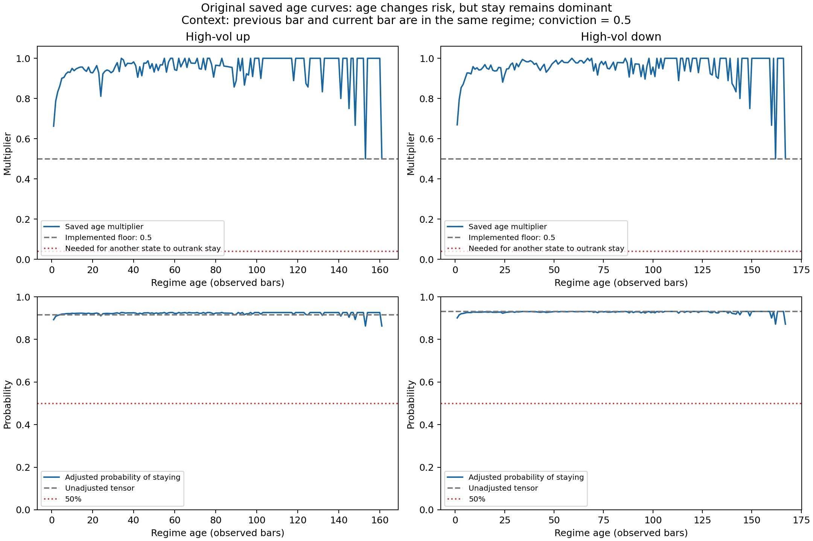

# Frozen OOS comparison: DCMR versus second-order Markov

DCMR's duration/regime adjustments improved the ranking of imminent regime
changes on this sample, while top-state predictions were identical to the
simple second-order model. Overall probability-score improvement was not
established. The experiment does not test trading profitability.

## Protocol

- Model implementation: repository commit `624a893`; current `DCMR2` behavior
  matches the recovered original `SHMM2` source for identical inputs/weights.
- Training: 98,533 archived labeled observations, October 4, 2009–March 13, 2026.
- Inputs: recovered original transition tensor, age functions and model defaults.
  The saved tensor exactly equals training-only add-one-smoothed counts.
- No parameters were fitted or selected on the evaluation period.
- Yahoo Finance `CL=F`: 4,039 hourly bars, February 2–October 14, 2026.
  February/early March observations supply independent rolling-feature warmup.
  OHLC prices are rounded to cents, matching the historical update policy.
- OOS: March 16 00:00 UTC–October 14 17:00 UTC, 2026; 3,241 consecutive
  one-hour forecast/target pairs, including 329 actual regime changes.
  Excluded 147 next-observed-bar pairs spanning closures or missing hours.
- Forecast origin is after bar t closes; the target is the rule-based state at
  t+1 close. Inputs are the two most recent observed states and known age.
  `age + 1` follows the repository's existing forward-evaluation convention.
- Simple baseline: raw `T[S_(t-1), S_t, :]` without duration/regime adjustments.
- DCMR: saved age curves and default regime multipliers; conviction fixed at 0.5,
  matching the default pipeline. This compares the combined adjustments, not
  age alone. The RF/GB learned-conviction path was not evaluated.
- The archived and Yahoo price series were not spliced; independent warmup
  avoids unresolved timestamp alignment and feed discontinuities at the join.

## Recorded results

| Metric | DCMR | Simple second-order Markov |
|---|---:|---:|
| Next-hour regime accuracy | 89.8488% | 89.8488% |
| Top-ranked next-hour changes | 0 | 0 |
| Destination accuracy, conditional on an observed change | 67.7812% | 67.7812% |
| Log loss, lower better | 0.387554 | 0.387884 |
| Multiclass Brier score, lower better | 0.177032 | 0.176749 |
| Transition-risk ROC AUC, higher better | 0.743163 | 0.700910 |
| Transition-risk average precision, higher better | 0.241634 | 0.214448 |

All 3,241 top-ranked predictions are identical and also match a persistence
baseline. The 89.85% accuracy therefore demonstrates no incremental state
classification advantage. Conditional destination accuracy assumes a change
occurred; it does not mean the model anticipated 67.78% of regime changes.

The improvement concerns the ranking of hours by transition risk. Average
precision's constant-score baseline is the 10.15% observed change rate.
Mean DCMR transition probability was 11.36%; aggregate agreement is not proof
of full probability calibration.

A paired day-block bootstrap with 2,000 resamples and seed 42 gives the
following descriptive 95% intervals for DCMR minus the simple baseline:

| Difference | Estimate | 95% interval |
|---|---:|---:|
| Transition-risk AUC | +0.04225 | [+0.02751, +0.05804] |
| Transition-risk average precision | +0.02719 | [+0.01709, +0.03818] |
| Log loss | -0.000331 | [-0.001389, +0.000765] |
| Multiclass Brier | +0.000283 | [-0.000267, +0.000849] |

Thus the ranking differences are supported by this resampling calculation,
whereas overall log-loss/Brier improvement is not established.

## Original artifact verification and age behavior

The recovered original source/weights reproduced all saved historical summary
fields to within 5.2e-14, including historical next-state accuracy 87.5421%
and tensor flip-destination accuracy 55.6090%. This establishes artifact
consistency, not that the historical evaluation itself was out of sample.

The age scalar is empirical `S(a+1)/S(a)`, clipped at a minimum of 0.5.
It is not constrained to decline with age. For an established high-volatility
run and neutral conviction, minimum-scalar stay probability is still 86.28%
(up regime) or 87.16% (down regime). The adjustments change exit-risk weights
without necessarily making an exit the largest next-hour probability.
`hazard_mult` multiplies the stay weight; `baseline_scale` multiplies the entire
row and cancels on normalization. The runtime model was not changed here.



## Evidence and reproduction

- [comparison.json](evidence/comparison.json): exact aggregate scores, bootstrap
  intervals, training/test cutoffs and SHA-256 hashes of private inputs.
- [monthly.csv](evidence/monthly.csv): monthly aggregate comparisons.
- [validation.json](evidence/validation.json): portable replay agreement and checks.
- [artifact-verification.json](evidence/artifact-verification.json): original
  artifact fingerprints and historical replay agreement, without local paths.
- [resume wording](RESUME.md): four bullets supported by these results.
- [evaluation code](../../scripts/evaluation/compare_second_order.py) and
  [checks](../../scripts/evaluation/test_compare_second_order.py).

Datasets, individual forecasts and fitted input artifacts are deliberately
excluded. Exact replay requires locally held inputs matching the recorded
hashes; the repository alone does not contain enough inputs to reproduce the
numbers. A fresh Yahoo download may include historical revisions.

From the repository root, using Python 3.12 (recorded version 3.12.12):

```bash
python -m pip install -r requirements-evaluation.txt
python -B -m unittest scripts.evaluation.test_compare_second_order -v
python -B -m scripts.evaluation.compare_second_order \
  --train-parquet /path/to/CL_final.parquet \
  --transitions /path/to/transition_matrix.npy \
  --age-functions /path/to/age_functions.json \
  --yahoo-csv /path/to/yahoo_raw.csv \
  --test-start 2026-03-16T00:00:00Z \
  --as-of 2026-10-14T18:00:00Z \
  --output-dir evaluation-private/replay
```

The command is shown with Bash line continuations; PowerShell users can run it
as one line. Yahoo CSV format: one header row, timestamp as the first column,
then Open, High, Low, Close, Volume (Adj Close is accepted and ignored).
The replay writes only aggregate metrics and monthly summaries.

To acquire a new private snapshot with the same basic download settings:

```python
from pathlib import Path
import yfinance as yf

out = Path("evaluation-private")
out.mkdir(exist_ok=True)
bars = yf.download("CL=F", start="2026-02-01", end="2026-10-15",
                   interval="60m", auto_adjust=False, progress=False,
                   threads=False)
if bars is None or bars.empty:
    raise RuntimeError("Yahoo returned no hourly observations")
if bars.columns.nlevels > 1:
    bars.columns = bars.columns.get_level_values(0)
bars.to_csv(out / "yahoo_raw.csv")
```

## Limits

This is one retrospective chronological holdout, already inspected before the
paired comparison; it is not a fresh prospective validation period. Daily
bootstrap blocks may miss longer serial dependence. Yahoo continuous futures
can contain contract-roll effects and historical revisions. Rolling windows
count available bars rather than elapsed clock hours. Only 23 OOS targets
were low-volatility states, so this sample mainly tests high-volatility/chop.

The legacy evaluation's `next_regime_accuracy` and `next_direction_accuracy`
fields measure confidence, not empirical correctness. They were not used here.
The learned-conviction feature selection includes future-derived run-end
information; that path requires correction before a defensible evaluation.
Regime-risk ranking does not establish next-return prediction, position-sizing
benefits or trading profits after costs.
